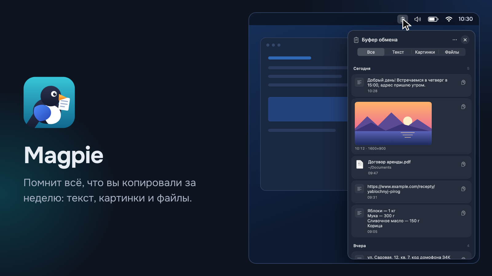
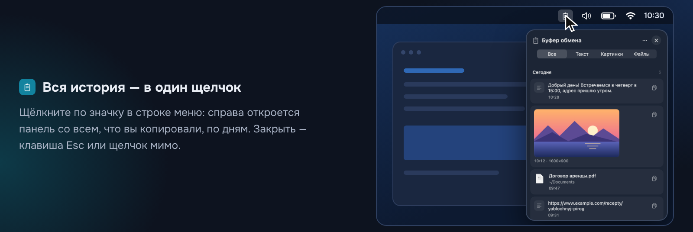
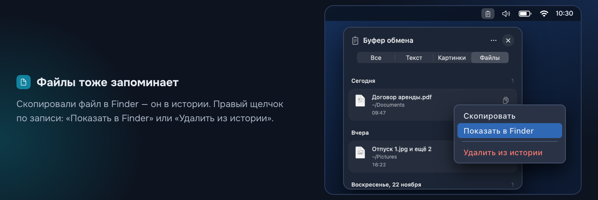

<p align="center"></p>

<h1 align="center">Magpie</h1>

<p align="center"><b>Помнит всё, что вы копировали.</b><br>
Бесплатно, для Mac с macOS 14 Sonoma и новее. Без аккаунтов и рекламы, в интернет ничего не отправляет.</p>



## Что это и зачем

Обычно Mac помнит только последнее, что вы скопировали. Скопировали адрес, потом ссылку, и адреса уже нет.

Magpie (по-английски «сорока») тащит к себе всё, что вы копируете: текст, картинки, файлы. Нужно что-то вчерашнее? Откройте панель, щёлкните по записи и вставьте как обычно.

## Что умеет







## Как установить

1. Откройте **Терминал**: Программы → Утилиты → Терминал.
2. Скопируйте туда эту строку и нажмите Enter:

   ```bash
   curl -fsSL https://raw.githubusercontent.com/Egrom92/magpie/main/install.sh | bash
   ```

3. Готово: в строке меню появился значок — планшет со списком.

Если появится окно с предложением установить инструменты Apple, нажмите «Установить», подождите 5–15 минут и повторите шаг 2. Это бесплатно и нужно один раз.

## Как пользоваться

| Что сделать | Как |
|---|---|
| Открыть историю | щёлкните по значку в строке меню |
| Вернуть запись | щёлкните по ней, затем вставьте: ⌘V |
| Показать только текст, картинки или файлы | кнопки вверху панели |
| Удалить одну запись | правый щелчок по записи → «Удалить из истории» |
| Найти скопированный файл | правый щелчок по записи → «Показать в Finder» |
| Удалить всё | правый щелчок по значку → «Очистить историю…» |
| Не запускать при включении Mac | правый щелчок по значку → «Запускать при входе в систему» |
| Закрыть панель | Esc, крестик или щелчок мимо |

## Частые вопросы

**Кто видит мою историю?** Только вы. Она хранится на вашем Mac и никуда не отправляется.

**Пароли сохраняются?** То, что менеджер паролей пометил как секрет, в историю не попадает. Если скопировать пароль из обычной заметки, Magpie не отличит его от другого текста. Такую запись можно удалить правым щелчком.

**Сколько хранится история?** 7 дней, не больше 1000 записей. Старое удаляется само.

**Файлы копируются в Magpie?** Нет, он помнит, где файл лежит. Если файл перенесли или удалили, в записи будет об этом сказано.

**Почему запись не повторяется, если скопировать то же самое?** Она просто поднимается наверх.

## Обновить или удалить

**Обновить:** повторите команду установки, история сохранится.

**Удалить** вместе со всей историей:

```bash
curl -fsSL https://raw.githubusercontent.com/Egrom92/magpie/main/uninstall.sh | bash
```

## Другие программы

- [2pic](https://github.com/Egrom92/2pic) — скриншоты и видео с экрана
- [Oops](https://github.com/Egrom92/oops) — исправляет текст, набранный не в той раскладке
- [Peekaboo](https://github.com/Egrom92/peekaboo) — прячет лишние значки в строке меню

<sub>Бесплатно, лицензия [MIT](LICENSE).</sub>
